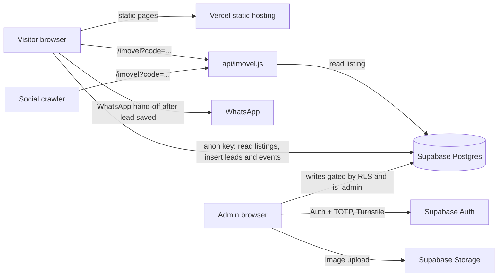

# New Home Imóveis

Portuguese-language real-estate website with property search, listing pages, WhatsApp lead capture and an administration panel.

**Client:** Built for New Home Imóveis, a real-estate agency in Rio de Janeiro.

**Live site:** https://new-home-imoveis.vercel.app

## Features

- Public pages: home, listing search, property detail, company, financing estimator and privacy policy
- Listing search with filters (purpose, type, region, price range, bedrooms) and pagination
- WhatsApp lead capture: contact requests are saved to the Supabase `leads` table before the visitor is handed off to WhatsApp, so a lead is not lost if the hand-off fails
- Favourites stored per browser, with a page that resolves them against live listings
- Per-listing Open Graph metadata for social sharing, generated by `api/imovel.js`
- First-party conversion events written to the Supabase `events` table; no third-party analytics scripts
- Admin panel (`/admin`): listing management, image upload, lead inbox and a security view for TOTP enrolment
- Admin login protected by Supabase Auth with optional TOTP two-factor and optional Cloudflare Turnstile

## Stack

- React 18, bundled with esbuild (all JavaScript is self-hosted, no CDN scripts)
- Supabase: Postgres with Row Level Security, Auth (including TOTP MFA), Storage
- Cloudflare Turnstile on the admin login
- Vercel: static hosting plus one serverless function (`api/imovel.js`)

## Architecture



The site is a set of static pages, each with its own bundle. The browser talks to Supabase directly with the public anonymous key, so Row Level Security is the security boundary. The only server-side code is `api/imovel.js`: social crawlers do not execute JavaScript, so `/imovel?code=...` is served by this function, which reads the listing and injects the real title, description and cover image into the page shell (`templates/imovel.html`).

## Repository structure

```text
api/imovel.js           Serves /imovel with per-listing Open Graph metadata
templates/imovel.html   Page shell used by that function (copied to v1/ for local dev)
scripts/build.mjs       Generates config.js and builds the JS bundles
scripts/verify-browser.mjs  Playwright and axe-core browser checks
supabase/migrations/    Tables, RLS policies, admin authorization and Storage setup
v1/                     Static site: HTML, CSS and JSX source
v1/dist/                Generated bundles (not tracked)
vercel.json             Build, rewrite and security header configuration
```

## Local setup

Requirements: Node.js 20+.

```bash
npm install
cp .env.example .env      # fill in the values listed below
node --env-file=.env scripts/build.mjs
npx serve v1
```

Re-run the build after editing a JSX source file. `v1/config.js` and `v1/imovel.html` are generated by the build and are not tracked in Git.

Environment variables (see `.env.example`):

- `SUPABASE_URL`: Supabase project URL
- `SUPABASE_ANON_KEY`: public anonymous key only
- `TURNSTILE_SITE_KEY`: optional Cloudflare Turnstile site key for the admin login
- `SITE_URL`: absolute site origin, used for canonical and Open Graph URLs in `api/imovel.js`

Optional browser checks: `npm run verify:browser` (uses Playwright against a running local server; set `VERIFY_URL` if it is not on `http://127.0.0.1:8080`).

## Supabase setup

1. Create a Supabase project and run every SQL file in `supabase/migrations/` in numeric order.
2. Create the administrator user in Supabase Authentication.
3. Add that user to the allowlist:

```sql
insert into public.admin_users (user_id)
values ('YOUR-AUTH-USER-UUID');
```

4. In the dashboard, enable TOTP under Authentication, Providers, MFA, then enrol an authenticator from the admin panel's Segurança view.
5. Optionally enable Cloudflare Turnstile under Authentication, Attack Protection, and set `TURNSTILE_SITE_KEY` to the matching site key.

## Deployment

Deployed on Vercel. Set the four environment variables above in the project settings. `vercel.json` runs `npm run build`, serves `v1/` with clean URLs, rewrites `/imovel` to `api/imovel.js`, and applies the security headers.

## Security notes

- Row Level Security is enabled on `properties`, `leads`, `events`, `admin_users` and Storage objects.
- Every administrative write goes through `public.is_admin()`, which checks membership in the `admin_users` table.
- Anonymous visitors can read active listings and insert into `leads` and `events`; only administrators can read or delete leads and read events.
- Only the public anonymous key is used in the browser. A service-role key must never be committed or exposed to the frontend.
- `vercel.json` sets a Content Security Policy with `script-src 'self'` (plus Cloudflare Turnstile on `/admin`), HSTS, `X-Content-Type-Options`, `Referrer-Policy` and a restrictive `Permissions-Policy`. The admin route also sets `frame-ancestors 'none'`, `noindex` and `no-store`.
- Images are re-encoded to WebP in the browser before upload, and the Storage bucket enforces its own MIME and size limits.
